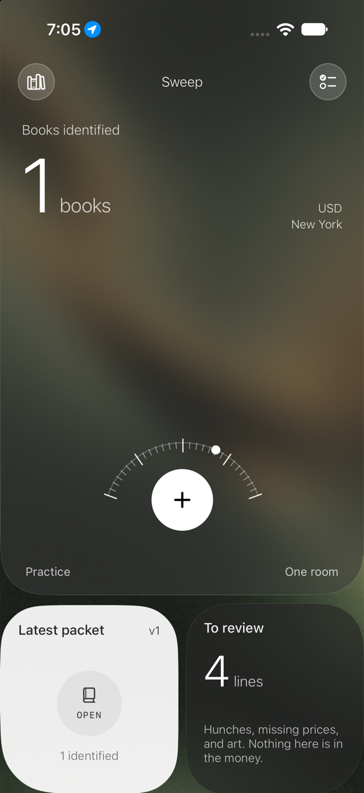
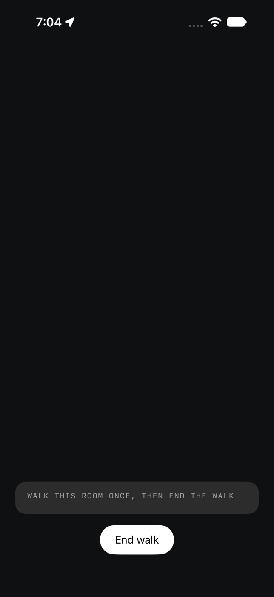
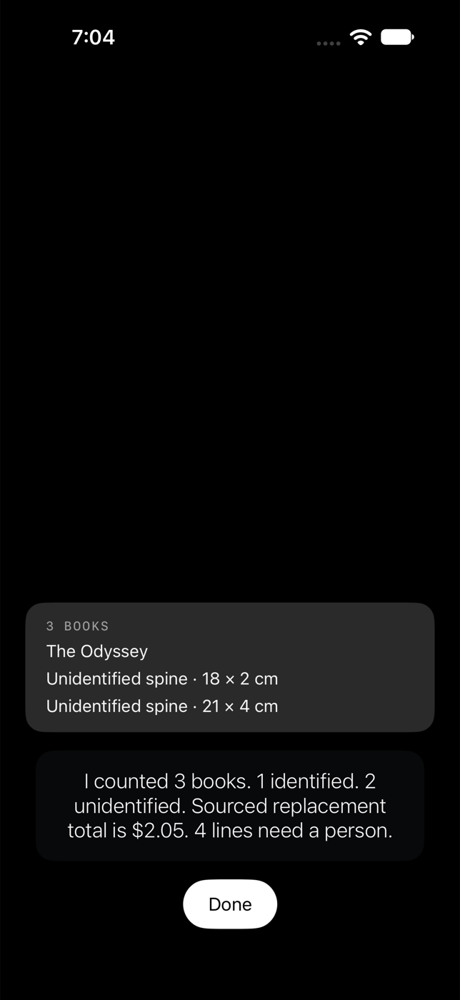
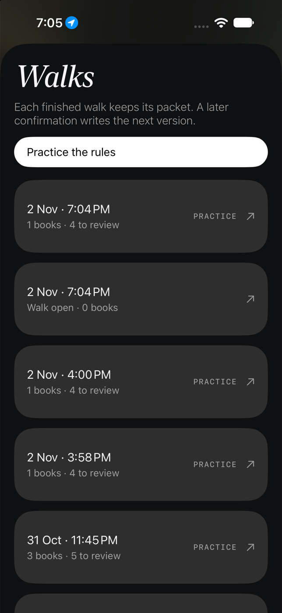
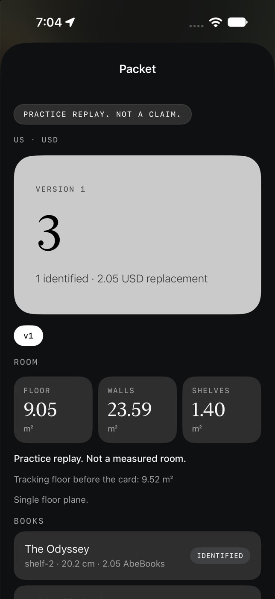
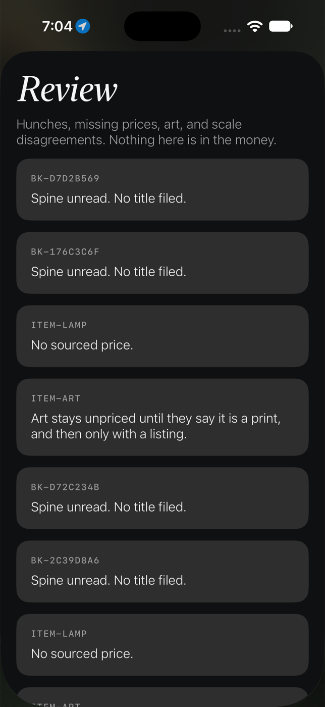
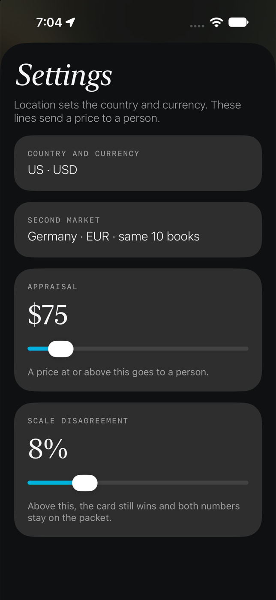

# Sweep

Sweep is a native iPhone app for one contents claim. A person walks one enclosed room once. The phone measures, reads, and prices. The voice only says what the phone has already decided.

This repository is the Cozmo take-home for the [Library Contents Claim Agent](https://docs.google.com/document/d/1U-Q1EBCZl9hDmOzVfPOmk453Qe5UAM_AZKcmISPbcec/edit). The locked rules are in [ASSIGNMENT.md](ASSIGNMENT.md). The remote is [github.com/XIVASSS/cozmoaiassig](https://github.com/XIVASSS/cozmoaiassig).

It is for a reviewer who has to see one room become a claim packet: books, other contents, a scale, a second market, and a queue of things a person still has to look at. It is not a login, a policy tool, or a carrier connector.

## Run it

1. Open `Sweep.xcodeproj` in Xcode 16 or newer. The project targets iOS 17 and is portrait only. The bundle id is `ai.hellocozmo.sweep`.
2. Pick your iPhone as the run destination and select your development team. The live camera, the microphone, and location need the phone. Trust the developer certificate on the phone the first time iOS asks.
3. A simulator can open Home, Walks, Review, Settings, and **Practice the rules**. The simulator camera stays black. The screenshots below were taken on the iPhone 18 Pro simulator.
4. Optional keys go in `Secrets.xcconfig` at the repo root. Copy the names from `.env.example`. The file is gitignored. The app runs with the keys empty: prices stay blank, and the phone speaks the instructions itself. Open Library does not need a key.

```
GEMINI_API_KEY=
GOOGLE_BOOKS_API_KEY=
ABEBOOKS_CLIENT_KEY=
GEMINI_LIVE_MODEL=gemini-2.5-flash-native-audio-preview-12-2025
GEMINI_TEXT_MODEL=gemini-2.5-flash
```

`Config/Config.xcconfig` holds the empty defaults and then optionally includes `Secrets.xcconfig`. Those values are written into `Config/Info.plist` as `GeminiAPIKey`, `GoogleBooksAPIKey`, `AbeBooksClientKey`, `GeminiLiveModel`, and `GeminiTextModel`. `AppSecrets` reads them at launch. A value that is still `$(SOME_KEY)` is treated as empty.

The unit tests cover the card, the rule that tracking and the card are not averaged, hunches staying out of the money, one spine staying one book, and totals. From this folder:

```
xcodebuild -project Sweep.xcodeproj -scheme Sweep -destination 'platform=iOS Simulator,name=iPhone 18 Pro' test
```

The last run of that suite was 37 tests, all passing.

## What the assignment requires

The product is one continuous pass of one room. The person is not asked to pull books down, scan barcodes, or photograph books one by one. The camera stays off until a walk starts.

| Requirement | What the app does |
| --- | --- |
| iPhone, no LiDAR | ARKit motion tracking plus on-device Vision. No RoomPlan. |
| Scale | A bank card, ISO ID-1, 85.60 mm by 53.98 mm. Books use the card. The room uses the card’s correction of the tracking. If they disagree past the threshold, both numbers stay on the packet and they are not averaged. |
| Eyes | Vision text, rectangles, image classification, blur, and glare. Frames are not sent to a cloud OCR. |
| Mouth | The state machine chooses the sentence. Gemini Live may speak that sentence when a key is present. The model is never asked for a title, a price, or a total. |
| Ear | On-device speech. An unclear phrase can be classified by Gemini into a fixed list: confirm, first edition, skip shelf, print, original, United States dollars, or none. |
| Locale | The running app reads the country and currency from the phone’s location and starts the walk. The assignment text still says the claim locale is confirmed out loud or with a chip. That question was removed because it stopped the scan. |
| Second market | Germany, euros, for the same ten identified books. Empty when AbeBooks returns nothing. |
| A weak read | A hunch. Spoken as a hunch, stored in `candidate_title`, status `unidentified`, kept out of the identified count and the money until the person keeps it. |
| Appraisal | First edition, signed, antiquarian (first published before 1850), art that is not confirmed as a print, and any sourced price at or above the threshold. Default 75 USD. |
| Packet | Each finished walk writes `claim_packet.json` and `report.html`. A later confirmation writes the next version. |

Pass bars, measured against a room counted by hand:

- Book count within 5 percent.
- At least 70 percent of human-legible spines correct, and no more than 3 percent confidently wrong.
- Spine size within 15 percent on 20 hand-measured spines.
- Book prices within 25 percent of 15 hand-checked prices of the same source type.
- At least 80 percent of non-book items in the right category.
- Floor area within 10 percent. Wall area within 15 percent.
- Packet within 5 minutes of the end of the walk.

Those bars were not met on the shelves that were graded. The comparison is in [How the reading changed](#how-the-reading-changed). What was never measured is in [What is not done](#what-is-not-done).

## Pages

### Home

The count is identified books on the latest finished packet. The city and the currency come from location. On this simulator that resolved to New York and USD. On the phone it is the city the phone is in. The dial’s plus starts one room. **Practice** starts the scripted replay. **Sweep** opens Settings. The left card opens Walks. The right card opens Review.



### The walk

Plus opens the camera and the walk starts. There is no currency question. The line under the picture says to walk the room once, then end the walk. Spines show up as they are logged. **End walk** is the only way it finishes. The phone then reads the saved frames, prices what it can, and speaks the count. The simulator picture is black because there is no camera. On the phone this is the live preview.



After a finished pass the same screen reads the result back. This one is the practice replay: three books, one identified, a sourced total, and four lines that still need a person.



During a real walk the voice asks at most twice. You can still answer if it asked something. Most of the time you only show the shelves.

### Walks

Every finished walk stays in the list. A practice row is labeled practice. Opening a row opens the packet. **Practice the rules** runs the same rules on scripted observations and is not a claim.



### Packet

The packet page is one session. It shows the version, the room numbers, every book, other contents, the Germany euro rows when they exist, the review reasons, the frames, and share links for the JSON and the HTML report.

A hunch, and only a hunch, has a check and a cross on this page and on Review. A hunch is an unidentified line that still has a candidate title and has not been removed.

- Check keeps it, searches the catalogue again, and prices whatever comes back. If it is one of the ten identified books, the Germany euro quote is fetched too.
- Cross leaves the line in the file and takes it out of the totals.

Identified books do not get those buttons. The packet in the screenshot is the practice replay, so it is labeled **Practice replay. Not a claim.** The room numbers there are scripted. A real walk leaves floor, walls, and shelves empty until a card has locked a scale.



### Review

Review is the task list. Nothing on it is in the money. The rows in this shot are unread spines, a lamp with no listing, and framed art that stays unpriced until someone says it is a print and a listing exists. Those rows are not hunches, so they have no check and no cross. A hunch row shows the candidate title and the two buttons.



### Settings

Location has already chosen the country and currency. Settings shows that pair, the second market, the appraisal threshold, and the scale-disagreement threshold. Above the disagreement threshold the card still wins and both numbers stay on the packet.



## What a walk files

On the phone, a finished walk writes a folder under Documents:

`sessions/<id>/frames/`
`sessions/<id>/events.json`
`sessions/<id>/summary.json`
`sessions/<id>/packets/vN/claim_packet.json`
`sessions/<id>/packets/vN/report.html`

A title is filed only when on-device text and a catalogue record agree, or when the person keeps a hunch. A price is filed only with a source name, a URL, and the time it was retrieved. Replacement comes from an AbeBooks new listing or a Google Books list price in the claim currency. Used value comes from an AbeBooks used listing. Another currency is converted with a Frankfurter rate, `converted: true`, and both URLs. No listing means a null amount, not zero.

Centimetres come only from the card and the current distance. No card means null dimensions. Room area comes only from planes seen on that walk, multiplied by the card correction. `scale_method` names that method. Totals are the sum of the lines. An empty field is correct when the system does not know.

## What was looked after

These are the parts that took the time, because a wrong book is worse than a missing one.

- The card is the ruler. Tracking is corrected by `0.0856 / arkitCardMeters`. The two numbers are never averaged. A square is rejected. The card has to look like an ID-1 rectangle.
- Identity is on the device. Open Library is searched first, then Google Books. A line becomes identified only when the spine text and the catalogue record agree. A scrap of OCR stays a hunch.
- One physical spine is one book. A subtitle and the author on that spine stay with the title. The next spine does not. A sideways shelf of horizontal title bands and an upright shelf of vertical spines use the same rule. A screen full of equal lines, a keyboard, and a thumbnail strip are not a shelf of books.
- A second, worse reading of a book already kept is dropped. A fragment such as “THE ROAD TO” or “ELEPHA” is dropped when those words already sit inside a longer title. “The Story of B. S. Johnson” is not filed as a second book beside *Like a Fiery Elephant*.
- Hunches stay out of the identified count and out of the money until someone keeps them. Skipping a shelf drops that shelf from the totals and leaves the lines in the file.
- A first edition, a signed book, a book first published before 1850, and a price at or above the threshold go to a person. The title is kept. The price is cleared. Framed art stays in appraisal until the person says it is a print, and it still has no price until a listing exists.
- The report pass reads the saved frames after **End walk**, instead of trusting whichever frame happened to be sharp while the phone was moving. The whole frame is kept when it is already a clear shelf. Slices are used when the full frame is smeared and the slices recover real words.
- Speech does not invent a title, a price, or a total. The sentence comes from the phone. Gemini, when a key is present, may speak that sentence or classify an unclear phrase into the fixed list.
- The home layout was put back after it got pulled in from the edges. The glass runs edge to edge. The two cards keep a gap. The count says books identified.

## How the reading changed

The early phone runs were not a shelf read. One session filed a single book and also filed FedEx and other text that was not a book. Home showed 41 identified and 52 lines to review. The voice talked too fast to be useful.

The next runs were real shelves, and they under-identified:

| When | What was in front of the phone | What the packet did |
| --- | --- | --- |
| Early scans | A shelf, two passes | 27 hunches, 3 identified. Then 8 identified and 32 hunches. |
| History shelf | About 50 volumes, photographed sideways on a laptop | About 29 lines and 7 identified. A later pass (session 3AEFD025) kept 79 frames, 33 lines, 11 identified. |
| First upright shelf | Spines standing up | Session 43515DE9. 33 lines, 4 identified. Each line of a spine had become its own book. |
| Alfie shelf, 2:00 PM | 11 books | Session 518C4EE2. 14 lines, 7 identified. |
| Alfie shelf, 2:27 PM | The same 11 books | Session 2FDA9AA7. 20 lines, 8 identified. 59 seconds, 29 frames. |
| Monopolists shelf, 2:50 PM | A different upright shelf | Session 6397BEDE. 12 lines, 4 identified. |
| Theology shelf, 3:01 PM | A third shelf | Session 0E7E04DB. 20 lines, 8 identified. |

On the 2:27 Alfie packet the names that were right were *Like a Fiery Elephant*, *Schoolishness*, *The Hemlock Cup*, *Air & Light*, *The Road to Middle-earth*, *Stylish Academic Writing*, and *The Bookseller of Florence*. The extra identified book was *B. S. Johnson*, which is the subtitle of *Like a Fiery Elephant*. Missing as names: *Alfie & Me* (only the subtitle “What Owls Know” survived), *A Guide for the Perplexed*, *The Shakespeare Requirement*, and *The Wandering Mind*. A sharp frame from that walk already contained 9 of the 11 titles. The packet was worse than the best frame because cropped frames, the thumbnail strip, and a second OCR of the same spine were all being kept.

On the Monopolists shelf the four right names were *Vertical* (Stephen Graham), *The End of Airports* (Christopher Schaberg), *Signor Marconi’s Magic Box* (Gavin Weightman), and *Neutral Buoyancy* (Tim Ecott).

On the theology shelf the right names included *The Broken Body*, *Set All Afire*, *Mother Angelica*, *What’s Wrong with the World*, *Razing the Bastions*, and *A Blessed Weakness*. One line was confidently wrong: *Measure for Measure*, from a spine that reads *Love Is the Measure*.

That is why the later reading work exists. A subtitle stays on its title. A fragment of a title already filed is dropped. Two books by the same author stay two books. An old book keeps its title and goes to appraisal instead of being blanked. A catalogue hit that does not agree with the spine stays a hunch, so a wrong title is less likely to receive a real price.

The three graded shelves still miss the pass bars. Book count was not within 5 percent. Legible spines were not at 70 percent correct with at most 3 percent confidently wrong. Those sessions were photographs of shelves on a screen, so spine centimetres, floor area, wall area, and the non-book list were not measured against a tape. Prices that exist are sourced. There is no hand-checked set of 15 prices in this repository to put beside them.

After that, the walk itself was simplified to the path that was used for a day of shelf tests: open the scanner, show the books, end the walk. Location sets the country and currency. The voice asks at most twice. That later path was not re-graded against the three shelves, so this README does not claim the pass bars moved.

## What is not done

- Shelf height and spine size. Centimetres are null until a bank card has locked a scale on that walk. The graded shelf photos had no card in frame, so those packets have no spine measurements to compare with a tape. The assignment wants 20 hand-measured spines within 15 percent. That tape pass was not done.
- Floor area and wall area. They are computed only from planes seen on the walk, multiplied by the card correction. The shelf-photo sessions have no floor. There is no taped room in this repository, so the 10 percent floor bar and the 15 percent wall bar are unmet. A scripted practice packet shows floor, walls, and shelves so the page can be checked, and it is labeled as not a measured room.
- The disagreement between the card and tracking is stored, and the figures are not averaged. It was not exercised against a taped room.
- Non-book contents. The packet can hold a lamp, framed art, and other objects, and art stays unpriced until someone says it is a print. The 80 percent category bar was not scored, because the graded sessions were shelves of books.
- Ground truth for a whole room. The assignment asks for a prep visit: every book counted, every legible spine read, 20 spines taped, floor and walls taped, other objects listed, 15 prices checked against the same kind of listing. That sheet is not in the repo.
- Floor-plan drawing, condition grades, and merging more than one room. The assignment leaves those out until one room’s packet is honest.
- A demo of the graded room, and a written architecture note beside the code. The behaviour is in this README and in `ASSIGNMENT.md`.
- The pass bars above. They are the standard. The measured shelves did not reach them.
- The assignment’s opening sentence is still the engine’s opening line. The running walk does not speak it. Location fills the country and currency, and the scan starts. That was a deliberate change so the scanner would not stop to ask.

## Remote configuration

Nothing is required for a walk that only needs to see spines and file hunches. These are the optional remote pieces.

| Key | Used for | If it is empty |
| --- | --- | --- |
| `GEMINI_API_KEY` | Gemini Live speaks the sentence the phone already chose. Gemini text classifies an unclear phrase into the fixed intent list. | The phone speaks with the system voice. Unclear speech that the on-device parser does not know becomes “none”. |
| `GEMINI_LIVE_MODEL` | Default `gemini-2.5-flash-native-audio-preview-12-2025`. | The default is used. |
| `GEMINI_TEXT_MODEL` | Default `gemini-2.5-flash`. | The default is used. |
| `GOOGLE_BOOKS_API_KEY` | A second catalogue after Open Library, and a list price in the claim currency. | Open Library still runs. Google Books is skipped. |
| `ABEBOOKS_CLIENT_KEY` | New and used listings, which are the replacement and used values. | Those amounts stay null. |

Open Library needs no key. Frankfurter is used when a listing comes back in another currency. The model is never given the job of writing a title, a price, or a total.

## Iterations

The app was built in this order. Each pass was a response to a run on the phone or to a rule in the assignment.

1. **The claim, before any pixels.** The brief was locked into `ASSIGNMENT.md`: one room, one walk, a bank card as the ruler, on-device vision, a voice that speaks only what the phone decided, hunches that are not money, United States dollars as the claim locale, Germany euros for the same ten books. The first build had the packet, the practice replay, the report, and the tests. The camera stayed off until a walk started.

2. **The first phone runs.** The count was wrong and the voice was too fast. A session filed one book and also filed FedEx and other text that was not a spine. Home showed 41 identified and 52 lines to review. That is the baseline the later reading work is measured against.

3. **A continuous sweep.** The walk stopped asking for books one by one. The inventory sits under the camera. A soft, fast, or missed shelf gets a physical instruction. Done is how the walk ends.

4. **The home.** The glass runs edge to edge, with the count, the dial, and two cards. Later layout passes pulled the glass in from the edges and closed the gap between the cards. Those were put back. The labels were then brought in line with the assignment: books identified, Practice, One room, the review card.

5. **Reading a shelf from the frames.** Early shelf scans returned 27 hunches and 3 identified, then 8 identified and 32 hunches. The history shelf, shot sideways, was about 29 lines and 7 identified. Saving every sharp frame and reading them after the walk (3AEFD025) reached 33 lines and 11 identified. The first upright shelf (43515DE9) went the other way: 33 lines and 4 identified, because each line of a spine had been filed as its own book.

6. **One spine, one book.** Subtitle and author stay with the title. The next band is the next book. The same rule covers a sideways history shelf and an upright shelf. A page of equal lines is not a stack of books. Fragments of a title already kept are dropped. A second OCR of the same book is dropped. This is covered by the unit tests, including the Alfie titles, *The Bookseller of Florence* with “of Florence” on the next line, and two books by Helen Sword staying separate.

7. **The three graded shelves on 2 November.** The Alfie shelf moved from 14 lines and 7 identified to 20 lines and 8 identified, with one confidently wrong extra. The Monopolists shelf was 12 lines and 4 identified. The theology shelf was 20 lines and 8 identified, with *Measure for Measure* filed from *Love Is the Measure*. Catalogue agreement was tightened so a weak string stays a hunch. Appraisal books keep their title and are not priced. None of the three shelves met the pass bars.

8. **The quiet scan.** The currency question was blocking the camera. Location now sets the country and currency, the walk starts, and you show the shelves. The voice still listens, and it asks at most twice in a walk.

9. **Hunches you can keep or drop.** On the packet page and on Review, each hunch has a check and a cross. Check searches that book online again and prices it. Cross removes it from the totals and leaves the line in the file. Identified books are left alone.

## Layout of the code

- `Sweep/Domain/WalkEngine.swift` chooses the phase and the sentence.
- `Sweep/Domain/MeasureMath.swift` is the card, the scale, the blur and glare, and the rule that turns lines into books.
- `Sweep/Services/SweepCapture.swift` is the camera, Vision, and the frames.
- `Sweep/Services/CatalogueClient.swift` searches Open Library, then Google Books.
- `Sweep/Services/PricingService.swift` asks AbeBooks and Google Books, and converts with Frankfurter.
- `Sweep/Services/VoiceBridge.swift` speaks and listens. Gemini is optional.
- `Sweep/Services/PlaceLocator.swift` reads the city, the country, and the currency.
- `Sweep/Domain/PacketBuilder.swift` sums the lines and builds the review queue. Totals are not typed in by hand.
- `Sweep/Domain/ReportRenderer.swift` writes the HTML report.
- `Sweep/Domain/PracticeWalk.swift` is the scripted replay. It is labeled practice.
- `Sweep/Views` is Home, the walk, Walks, the packet, Review, and Settings.
